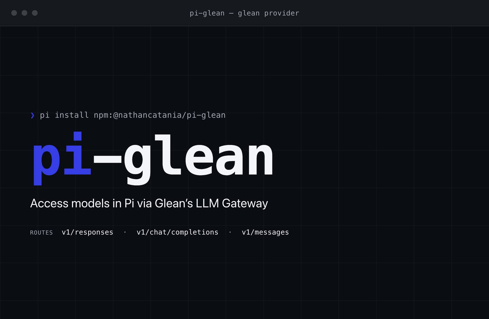

# pi-glean

A Pi provider for the Glean LLM Gateway.

The provider discovers the Glean model catalog at startup and routes each model to the API that Glean exposes for that model.

> [!NOTE]
> This is a community repository. It is not endorsed, sponsored, managed, or supported by Glean. You use the contents at your own risk.

## Quick Start

### Requirements

* Node.js 22.19.0 or later

### Install

Install the package from GitHub:

```bash
pi install git:github.com/nathancatania/pi-glean
```

OR

Install the package from npm:

```bash
pi install npm:@nathancatania/pi-glean
```

### Log in

Run `/login`, then select **Glean**. Pi asks for two values.

| Prompt | Value |
| --- | --- |
| Glean tenant id | The label before `-be.glean.com`. For `https://acme-be.glean.com`, enter `acme`. |
| Glean LLM Gateway API key | The LLM Gateway API key for your tenant. **Note:** This is *different* to the Client API key. |

For headless runs, set `GLEAN_LLM_API_KEY` and `GLEAN_TENANT_ID` as environment variables instead. A stored credential takes priority over the variables.

Pi verifies the pair against the Glean model catalog `https://{{GLEAN_TENANT_ID}}-be.glean.com/rest/api/v1/models`. If successful, Pi stores the API key and the tenant id in `~/.pi/agent/auth.json`.

## Environment variables

Use the environment variables for CI and headless runs:

| Variable | Value |
| --- | --- |
| `GLEAN_LLM_API_KEY` | The Glean LLM Gateway API key. |
| `GLEAN_TENANT_ID` | The Glean tenant id. |

A stored credential wins over the environment variables. The provider uses `GLEAN_LLM_API_KEY` and `GLEAN_TENANT_ID` when no credential exists.

## Headless and CI runs

Use the environment variables for CI and headless runs:

| Variable | Value |
| --- | --- |
| `GLEAN_LLM_API_KEY` | The Glean LLM Gateway API key. |
| `GLEAN_TENANT_ID` | The Glean tenant id. |

You must set both variables in the environment. Pi will use them when no stored credential exists.

```bash
export GLEAN_LLM_API_KEY="<api key>"
export GLEAN_TENANT_ID="acme"

pi install npm:@nathancatania/pi-glean
pi --print --model glean/<model id> "Summarize the failing test"
```

`--print` sends one prompt, writes the answer to stdout, and exits. Read the model ids of your tenant first:

```bash
pi --list-models glean
```

## Model routing

Glean publishes a `supportedEndpoints` list for each model. Pi picks the first match in this order.

| Glean endpoint | Pi API | Request URL |
| --- | --- | --- |
| `v1/responses` | OpenAI Responses | `https://{tenant}-be.glean.com/rest/api/v1/openai/v1/responses` |
| `v1/chat/completions` | OpenAI Chat Completions | `https://{tenant}-be.glean.com/rest/api/v1/openai/v1/chat/completions` |
| `v1/messages` | Anthropic Messages | `https://{tenant}-be.glean.com/rest/api/v1/anthropic/v1/messages` |

The Responses API wins when a model lists both OpenAI endpoints. Glean supports Chat Completions for streaming only, and Pi always streams.

Every route sends `Authorization: Bearer <api_key>`. The Anthropic route also sends `anthropic-version: 2023-06-01`. Pi removes the `x-api-key` header on that route, because the Anthropic SDK adds it by default.

The provider marks a Claude model for adaptive thinking when Glean lists the `xhigh` or `max` thinking level.

## Authentication headers

Every route sends `Authorization: Bearer <glean_api_key>`.

The Anthropic route also sends `anthropic-version: 2023-06-01`. The provider removes the `x-api-key` header, because the Anthropic SDK adds it by default.

## Catalog mapping

Pi converts each Glean catalog entry into a Pi model.

| Glean field | Pi field |
| --- | --- |
| `displayName` | Model name |
| First `modelAliases` entry, then `model` | Model id |
| `supportsReasoning` | Reasoning flag |
| `supportedThinkingLevels` | Thinking level map |
| `pricingPerInputToken`, `pricingPerOutputToken`, `pricingPerCachedInputTokenRead` | Cost per million tokens |
| `maxContextTokens`, `maxInputTokens` | Context window |
| `maxOutputTokens` | Output limit |
| `imageExtensions` | Image input |

An unlisted thinking level becomes `null`, so Pi clamps that level.

Pi assumes 128000 tokens when the entry carries no context size, and 8192 tokens when it carries no output limit.

## Supported models

The provider keeps models that use `v1/responses`, `v1/chat/completions`, or `v1/messages`.

The provider currently drops models with other endpoints. This includes Gemini `streamGenerateContent`, Bedrock `ConverseStream`, realtime, audio, image, and embedding models.

## Development

Test a local checkout for one run:

```bash
pi -e ./pi-glean
```

Run the tests:

```bash
npm test
```

Run the type check:

```bash
npm install
npm run check
```

The tests use the Node.js test runner and the Node.js type stripping. They do not need a Glean tenant.


## License

MIT. See [LICENSE](LICENSE).


## Report an Issue

- [Issues](https://github.com/nathancatania/pi-glean/issues)

